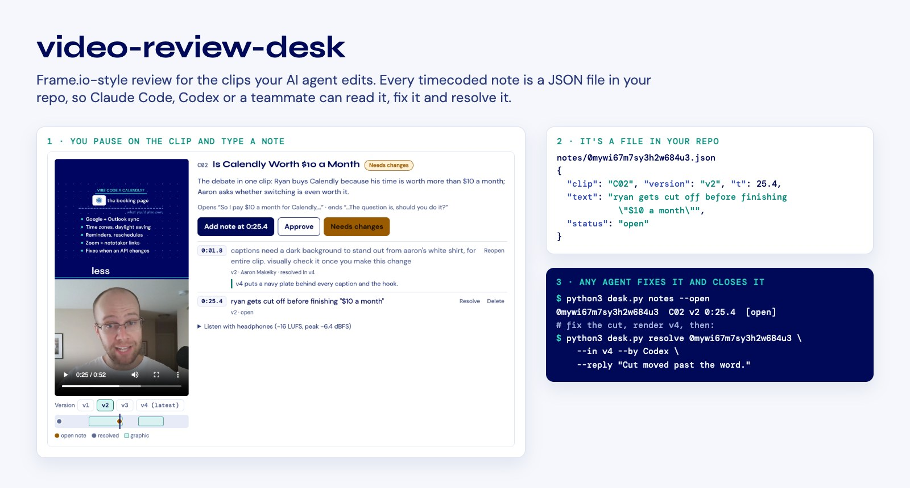
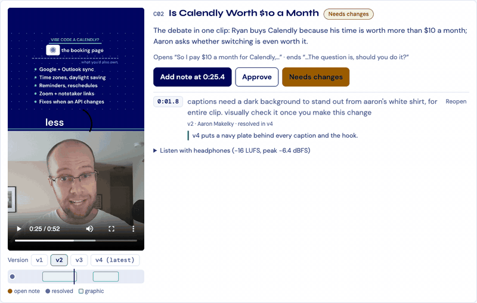
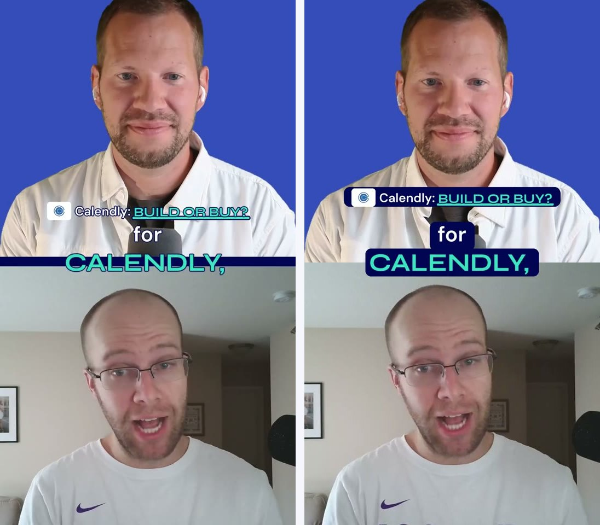

<p align="center">
  
</p>

# video-review-desk

Timecoded video review where every note is a file in your repo. Pause a clip, type what's wrong, and the note is saved as JSON pinned to that clip, that version and that second. Claude Code, Codex or a teammate reads it, renders the fix and marks it resolved.

One Python file, no dependencies, MIT licensed. [Try it](#try-it).

## Why

I edit podcast clips with coding agents, and reviewing their work was the weak part.

In a chat, there's no picture. I'd type "the caption around 25 seconds on clip 2 covers my shirt" and hope the agent opened the right version. My notes scrolled away with the rest of the conversation. When v3 came back, I couldn't see which notes it was supposed to fix.

The tools with a real review screen, the kind where you click on a frame and leave a comment, are paid platforms, and the comments live in their account. My agent can't read them without an integration.

So the notes go where the agent already works: the repo.

## How it works

<p align="center">
  
</p>

1. `desk.py serve` opens a page with every clip and every version. Pause anywhere and click **Add note at 0:25.4**.
2. The note is saved as `notes/<id>.json`. Inside a git repo, it's committed on its own, with a message like `Review note on C02 v2 at 0:25.4`.
3. The agent runs `desk.py notes --open`, makes the change and renders the next version.
4. It closes the note with `desk.py resolve <id> --in v4 --reply "what changed" --by Codex`. The page shows it resolved, with the version that fixed it and the reply, without a reload.

## A real one

These are two notes from a batch of [AI Rabbit Holes](https://aaronmakelky.com/ai-rabbit-holes) clips. On clip 2, version 2, I left:

- **0:01.8** captions need a dark background to stand out from aaron's white shirt, for entire clip
- **0:25.4** ryan gets cut off before finishing "$10 a month"

Version 4, with both fixed. The caption plate is on the right:

<p align="center">
  
</p>

The second note turned out to be a timing bug. The transcript ended Ryan's "month" at 521.565 seconds into the recording, but his mic held the word until about 521.89, and the cut at 521.705 clipped it. The full story is in [the write-up](https://aaronmakelky.com/blog/video-review-desk).

## Try it

```bash
git clone https://github.com/a-makelky/video-review-desk
cd video-review-desk
python3 desk.py --project example serve
```

Open http://localhost:8765/. The example has two clips, two versions each, and one resolved note. It needs Python 3.9 or newer, which Apple's Command Line Tools include on a Mac.

## Use it on your own videos

Put your renders in one folder, named `<clip>-v<N>.mp4` (`.mov`, `.m4v` and `.webm` work too):

```
review/
  media/
    hook-v1.mp4
    hook-v2.mp4
    walkthrough-v1.mp4
```

```bash
python3 desk.py init review --media media --title "Launch video"
python3 desk.py --project review serve --push
```

`init` writes `review/desk.json` with each clip and its versions. Add titles there if you like. When you render a new version, add it to the clip's `versions` list, or run `init` again. `--push` sends each note to GitHub as soon as it's saved.

## Hand it to your agent

Point the agent at your project folder and [AGENTS.md](AGENTS.md). That file has the whole loop: what to read, which commands to run, how to resolve a note and what to do with one it won't act on. A prompt can be as short as:

> Fix the open review notes in `review/` and resolve each one with the version that fixed it. Follow AGENTS.md.

## What gets saved

```
review/
  desk.json               clips and versions
  notes/<id>.json         one note
  approvals/<clip>.json   approved, or changes requested, for one clip
```

```json
{
 "id": "3f9a1c2b7d10",
 "clip": "hook",
 "version": "v1",
 "t": 1.5,
 "text": "Captions cover the face here; move them lower.",
 "status": "resolved",
 "by": "Sam",
 "resolvedIn": "v2",
 "reply": "Caption band moved to the bottom in v2.",
 "resolvedBy": "Codex"
}
```

Each note is its own file, so two people can leave notes at the same time without a merge conflict. Outside a git repo, the files are still saved; nothing is committed.

## Commands

| Command | What it does |
| --- | --- |
| `init DIR --media MEDIA --title T` | Writes `desk.json` from videos named `<clip>-v<N>.mp4`. |
| `serve [--port 8765] [--lan] [--push]` | The review page and the videos. |
| `notes [--clip ID] [--open] [--json]` | Lists notes and approvals. |
| `add CLIP VERSION SECONDS TEXT [--by NAME]` | Adds a note. |
| `resolve ID --in VERSION [--reply TEXT] [--by NAME]` | Marks a note fixed in a version. |
| `reopen ID` / `reply ID TEXT` | Reopens a note, or answers it without resolving. |
| `approve CLIP --version V [--changes] [--clear]` | Approves a clip, requests changes, or clears either. |
| `import PATH [--by-map OLD=New]` | Brings in notes exported as JSON files, one record per file. |
| `sync [--push]` | Commits hand edits, pulls with rebase, and pushes. |

Every command takes `--project DIR` (by default, the nearest folder above you with a `desk.json`) and `--no-commit`.

## Phones

`serve --lan` listens on your local network, so a phone on the same Wi-Fi can open `http://<your-computer>.local:8765/`. The page stacks into one column. There's no login, so anyone on that network can add notes; use it on a network you trust.

## Security

- The server listens on 127.0.0.1 unless you pass `--lan`.
- Changes are accepted only from the page itself. A request needs the page's `X-Desk` header, and one coming from another site is refused, so a web page you visit can't post notes to your desk.
- Video file names are checked against a strict pattern before anything is read from disk.

## Contributing

Bug reports, ideas and pull requests are welcome. Open an [issue](https://github.com/a-makelky/video-review-desk/issues) or a pull request.

This repo is published from the copy I use day to day, so pull requests aren't merged here directly. When I take one, I apply it to my copy, it syncs back to this repo, and I close the pull request with a link to the commit. You keep the credit.

## License

MIT. See [LICENSE](LICENSE).
